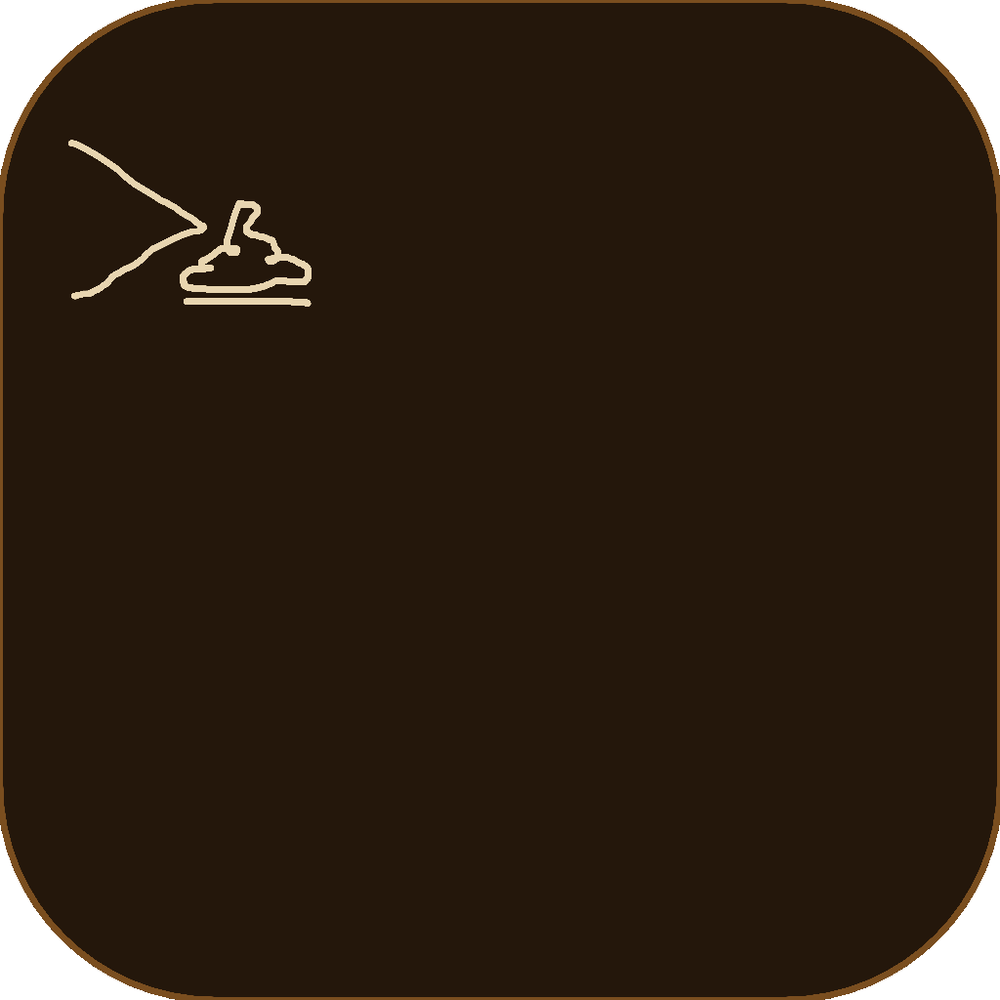

# poopterm 💩

Poopterm is a small, poop-colored terminal emulator written in Rust. It opens
your default shell in a native window, with a caramel frame and four built-in
color themes. It is a lightweight project and an intentionally incomplete
terminal emulator, so some command-line apps may not behave as expected.



## Features

- Starts the shell in `$SHELL`, falling back to `/bin/sh`.
- Supports basic cursor movement, 16-color, 256-color, and truecolor SGR,
  alternate-screen switching, and common editing and function keys.
- Keeps up to 5,000 lines of scrollback. Use the mouse wheel to browse it.
- Resizes the shell along with the window.
- Includes macOS, Catppuccin Mocha, Rosé Pine, and signature Poop themes.
- Includes a desktop launcher and icon for Linux and FreeBSD.

## Build and run

Install stable Rust with [rustup](https://rustup.rs), then build from the
project directory:

```sh
cargo run --release
```

To build without launching the app, run `cargo build --release`.

## Package managers

The Homebrew formula is available from the Poopterm tap. Install it with:

```sh
brew tap poopterm-labs/poopterm https://github.com/poopterm-labs/poopterm.git
brew install poopterm-labs/poopterm/poopterm
```

On macOS, Homebrew builds both the `poopterm` command and a `Poopterm.app`
bundle containing the `.icns` app icon. Open the installed app with:

```sh
open "$(brew --prefix)/opt/poopterm/Poopterm.app"
```

The command remains available for launching Poopterm from a terminal. The app
bundle lives in Homebrew's managed prefix, so Homebrew upgrades and uninstalls
keep it in sync with the command.

The AUR package recipe and its generated `.SRCINFO` are in `packaging/aur/`.
After the package is published, install it with your preferred AUR helper, for
example `yay -S poopterm`.

### Build dependencies

On Debian or Ubuntu:

```sh
sudo apt install build-essential pkg-config libx11-dev libxkbcommon-dev libwayland-dev
```

On Fedora:

```sh
sudo dnf install gcc pkgconf-pkg-config libX11-devel libxkbcommon-devel wayland-devel
```

On Arch Linux:

```sh
sudo pacman -S base-devel libx11 libxkbcommon wayland
```

On macOS, install the Xcode Command Line Tools if they are not already present:

```sh
xcode-select --install
```

On FreeBSD, install Rust, pkgconf, and the display-system libraries you use:

```sh
pkg install rust pkgconf xorg libX11 libxkbcommon wayland
```

## Themes

Poopterm includes macOS, Catppuccin Mocha, Rosé Pine, and signature Poop themes.
Press **Ctrl+Shift+T** to cycle through them. The selected theme is saved to a
config file and restored the next time you launch Poopterm.

The default config path is `~/Library/Application Support/poopterm/config.toml`
on macOS and `~/.config/poopterm/config.toml` on Linux and FreeBSD (or
`$XDG_CONFIG_HOME/poopterm/config.toml` when `XDG_CONFIG_HOME` is set). Create
the file and set `theme` to one of `macos`, `catppuccin`, `rosepine`, or `poop`:

```toml
theme = "catppuccin"
```

Set `POOPTERM_CONFIG` to use a config file at another path. `POOPTERM_THEME`
can override the saved setting for a single launch, for example:

```sh
POOPTERM_THEME=catppuccin cargo run --release
```

```sh
POOPTERM_THEME=rosepine poopterm
```

## Install on Linux or FreeBSD

Install system-wide (requires administrator access):

```sh
sudo make install
```

Install for your user on Linux:

```sh
PREFIX="$HOME/.local" make install
```

For a user install, make sure `~/.local/bin` is in your `PATH`. To uninstall,
run `sudo make uninstall` for a system install, or use the same `PREFIX` as the
user install:

```sh
PREFIX="$HOME/.local" make uninstall
```

## macOS app bundle

`cargo run` launches the executable directly. App launches use a login shell,
so zsh loads both `~/.zprofile` and `~/.zshrc`. Put Homebrew's `shellenv` setup in
`~/.zprofile` so GUI-launched shells inherit its PATH. For Apple Silicon:

```sh
eval "$(/opt/homebrew/bin/brew shellenv)"
```

For Intel Macs, use `/usr/local/bin/brew` instead. Commands such as `hyfetch`
must be installed and available on the PATH in that login shell.

## Compatibility notes

Poopterm has basic support for full-screen programs such as `nano` and `htop`,
including alternate-screen use and common navigation keys. It is not a complete
xterm implementation yet. Text selection, copy and paste, mouse reporting,
scroll regions, and some terminal control sequences are not implemented, so
applications that depend on those features may display or behave incorrectly.
The bundled font may not contain every symbol, and wide characters such as
emoji and some CJK characters do not yet occupy two terminal cells.

The shell is currently told that the terminal is `xterm-256color`; apps may
therefore try features Poopterm does not support yet.

## Font and license

Poopterm bundles DejaVu Sans Mono for Powerline as `assets/font.ttf`. The font is
distributed under the Bitstream Vera license, with public-domain changes. See
the [DejaVu font license](https://dejavu-fonts.github.io/License.html).

Poopterm is MIT licensed; see [LICENSE](LICENSE).
